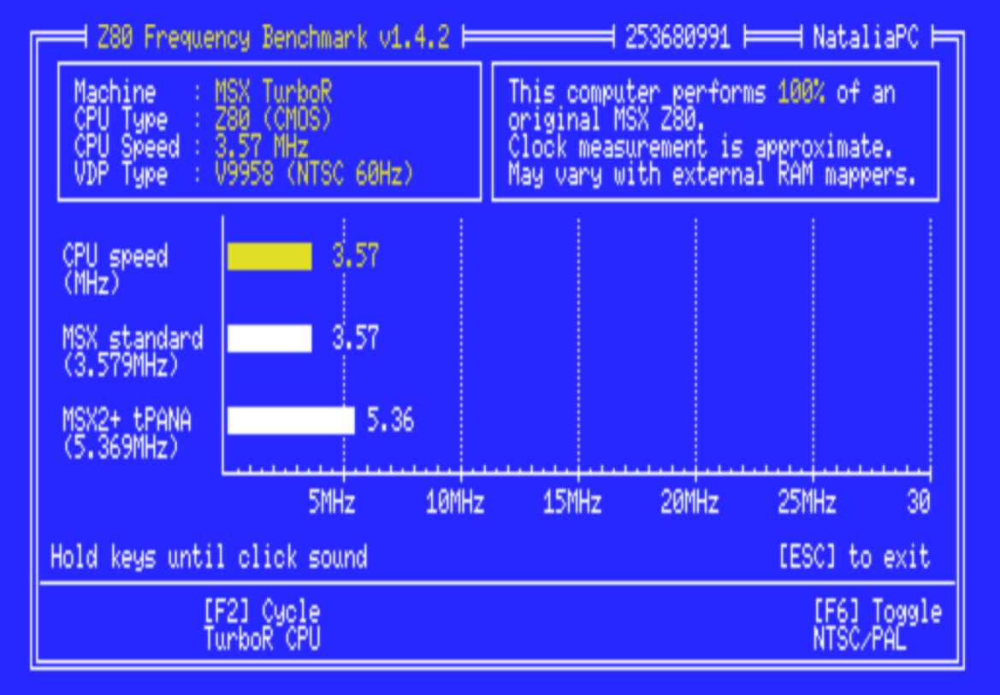

# MSX Z80 Frequency Benchmark

[[**Downloads page**](https://github.com/nataliapc/msx_z80bench/releases)]

**Z80BENCH** program allows you to measure and manage your MSX CPU speed.

It has been created with not only _Panasonic MSX_ with _TurboPana_ and _MSX TurboR_ machines in mind, but also _FPGA_ machines [_OCM/MSX++_](https://github.com/gnogni/ocm-pld-dev), and MSX based on boards and hardware developments like [_Tides-Rider_](https://genami.shop/blogs/news/requirements-to-assemble-a-tides-rider) and [_Taka-Nami_](https://genami.shop/blogs/news/knowing-the-taka-nami) that allow different CPU speeds.

The measurement is approximate and is based on the number of _VDP_ interrupts that occur during a test loop in `IM1` mode.

This means that for low clock frequencies the precision is higher and as the speed increases the margin of error also increases. But in the range of 3 to 20 MHz this error is practically negligible.

With longer test loops and longer duration, the margin of error would be reduced, but a compromise between precision and usability has been chosen.

The available options vary depending on which _MSX_ machine you run the program on.

The visual presentation and operation is based on similar programs that were developed for old _PCs_ under _MS-DOS_.

**🌟 You can help to improve this project by [starring](#more-stars) it! 🌟**



## Displayed Information

- **Machine:** MSX generation obtained from _BIOS ROM_ and manufacturer if available obtained from [_expanded I/O ports_](https://map.grauw.nl/resources/msx_io_ports.php#expanded_io).
- **CPU Type:** detection is performed by checking how specific opcodes behave for each CPU. `Z80`, `R800`, `Z280` (experimental) and `Z380` are detected. For `Z80` it also detects if it's `NMOS` or `CMOS`.
- **CPU Speed / Mem Speed:** result of the selected test (see [Speed tests](#speed-tests)).
- **VDP Type:** video chip detection (_TMS9918, V9938, V9958_). Output frequency is also shown (_NTSC/PAL_).

## Speed tests

Press **F5** to cycle the test:

- `CPU speed`: the original test loop, using only CPU registers. The result is the clock (MHz) a standard MSX Z80 would need to run it in the same time.
- `Mem 8bit`: reads **and** writes RAM one byte at a time (`LD A,(DE)` / `LD (DE),A`). The result is in kB/s.
- `Mem 16bit`: reads **and** writes RAM one word at a time at an even address (`POP DE` / `PUSH DE`). The result is in kB/s. CPUs with a 16-bit data bus, like the Z380, can do each access in one bus cycle.

### What the memory tests measure: reads and writes together

> [!IMPORTANT]
> The memory tests measure a **mix of reads and writes**, half of each. They do not measure the read speed or the write speed alone. If a machine writes to RAM more slowly than it reads (for example, with extra wait states on writes), the result is the average of both.

Each loop pass reads a value and writes it back to the same address, 4 times:

| Test | Read | Write | Each loop pass |
|---|---|---|---|
| `Mem 8bit` | `LD A,(DE)`: 1 byte | `LD (DE),A`: 1 byte | 4 reads + 4 writes = 8 bytes |
| `Mem 16bit` | `POP DE`: 2 bytes | `PUSH DE`: 2 bytes | 4 reads + 4 writes = 16 bytes |

The CPU also reads the instructions of the loop from RAM. These reads are not counted in the bytes moved.

### How the memory speed (kB/s) is calculated

Each memory test moves a known amount of data: every loop pass makes 8 accesses (4 reads and 4 writes), 8 bytes in `Mem 8bit` and 16 bytes in `Mem 16bit`. A test run is 131070 passes, so it moves 1048560 bytes (`Mem 8bit`: 524280 read + 524280 written) or 2097120 bytes (`Mem 16bit`: 1048560 read + 1048560 written). The program measures how long the run takes with the VDP interrupts (50/60 per second), the same way it measures the CPU speed, and divides:

```
speed (kB/s) = bytes moved / time (s) / 1000
```

1 kB is 1000 bytes. The bytes moved are the bytes read plus the bytes written. The value includes the whole test loop (the loop counter and the instruction fetches), so it is the read/write throughput of this loop, not the raw bandwidth of the RAM.

With the same CPU, `Mem 16bit` is faster than `Mem 8bit`, because `POP`/`PUSH` move 2 bytes in 11-12 clock cycles and `LD A,(DE)` moves 1 byte in 8. On an 8-bit data bus (Z80, R800) `Mem 16bit` is about 1.5 times `Mem 8bit`. A CPU that does each word access in one bus cycle gets a larger ratio.

### Reference values

The graph compares the current machine with these machines for the selected test:

| Machine | CPU speed | Mem 8bit | Mem 16bit |
|---|---|---|---|
| MSX standard (Z80 3.579MHz) | 3.57 MHz | 311 kB/s | 477 kB/s |
| MSX2+ _TurboPana_ (Z80 5.369MHz) | 5.36 MHz | 467 kB/s | 716 kB/s |
| _TurboR_ R800 DRAM mode | 20.59 MHz | 1254 kB/s | 1933 kB/s |

The _TurboR_ values were measured with openMSX (Panasonic FS-A1ST, NTSC). The _TurboPana_ values are the MSX standard ones multiplied by 1.5.

## Options

The options are only shown if they are detected as possible.

The keys must be held down until you hear a click sound, which is when each of the tests ends and keyboard can be read again.

- **F1:** Toggle _TurboPana_ CPU speed (_3.57MHz, and 5.36MHz_).
- **F2:** Cycle _TurboR_ CPU (_Z80, R800(ROM), and R800(DRAM)_).
- **F3:** Cycle _OCM_ Speed (_3.57MHz, 5.36MHz, 4.10MHz, 4.48MHz, 4.90MHz, 5.39MHz, 6.10MHz, 9.96MHz, and 8.06MHz_).
- **F4:** Cycle _Tides-Rider_ Speed (3.57MHz, 6.66MHz, 10MHz, and 20MHz).
- **F5:** Cycle the speed test (_CPU speed, Mem 8bit, and Mem 16bit_).
- **F6:** Toggle _NTSC/PAL_. CPU Speed may vary slightly when changing this value due to the different interrupts frequency (_60/50Hz_ respectively).

## Final Considerations

Clock measurement is approximate, and may vary when using external RAM mappers.

The number that appears in the border indicates the number of interrupts (x 1e6) that occurred during each iteration of the test loop.

## Acknowledgments

Thank you very much to everyone who has been testing the program so that it could become a reality.

### I hope you all find this useful! :D
NataliaPC

## More stars!

Please give us a star on [GitHub](https://github.com/nataliapc/msx_z80bench) if you like this project.

[](https://www.star-history.com/#nataliapc/msx_z80bench&Date)
## Star History

---
